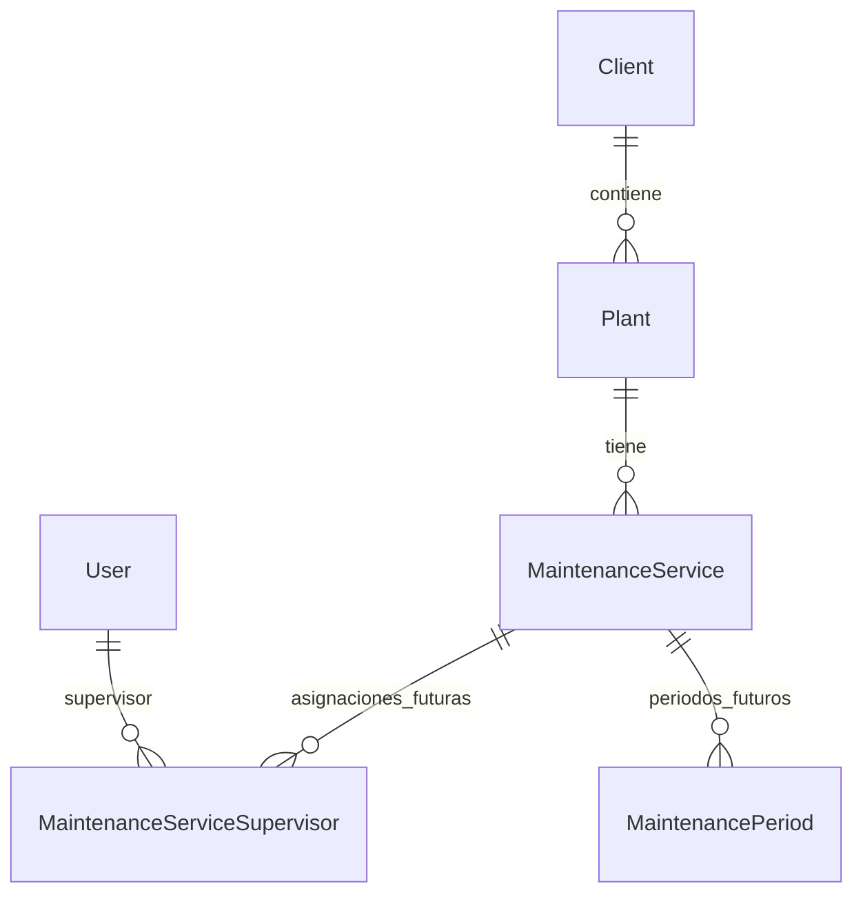

# Modelo de datos — guía conceptual, verificar migraciones antes de generar

Referencias: [instrucciones](../AGENTS.md), [dominio](../.ai/rules/kpgroup-domain.md), [decisiones](decisiones-tecnicas.md), [plan operativo](../PLANS.md) y [estado](estado-proyecto.md).
Fuente: `fuentes/Documentacion_Proyecto_Mantenimiento_Vias_KPGroup_v1.1.pdf`, sección 7 (págs. 11–16) y 8 (pág. 18). Los tipos son **conceptuales**.

| Tabla | Atributos clave | Relaciones / restricciones |
|---|---|---|
| `clients` | id, name varchar(150), short_name varchar(80) nullable, active, timestamps | `hasMany(Plant)`; nombre corto opcional según aclaración aprobada posterior |
| `plants` | id, client_id, name varchar(150), short_name varchar(80) nullable, active, observations nullable | `belongsTo(Client)`; nombre único **dentro del cliente** según aclaración posterior |
| `tracks` | id, plant_id, name varchar(120), code varchar(50)?, sketch_disk varchar(40)?, sketch_path varchar(255)?, active, timestamps | `Plant hasMany Track`; `Track belongsTo Plant`; unique `(plant_id, name)` y `(plant_id, code)` (code nullable); `hasMany(TrackSection)` |
| `track_switches` | id, plant_id, code varchar(50), name varchar(120), description?, active, timestamps | `Plant hasMany TrackSwitch`; `TrackSwitch belongsTo Plant`; unique `(plant_id, code)`; no tiene hijos ni relación con Track |
| `track_sections` | id, track_id, name varchar(120), code varchar(50)?, active, timestamps | unique `(track_id, name)` y `(track_id, code)` (code nullable); solo `belongsTo(Track)`; nombre operativo manual |
| `maintenance_services` | id, plant_id, name, order_number?, start_date, end_date?, report_frequency, status, notes? | planta 1:N servicios |
| `maintenance_service_supervisors` | service_id, user_id, start_date, end_date?, active | asignaciones temporales N:M; no exclusividad |
| `maintenance_periods` | service_id, fechas, status, creador, envío, aprobación, cierre | servicio 1:N periodos |
| `maintenance_activity_categories/types` | categoría, concepto, subopción, unidad, location_type, inventory_behavior | conceptos jerarquizados |
| `maintenance_programs/items` | period_id, concepto, ubicación, fecha, asignado?, estado | programa por periodo |
| `maintenance_activities/photos` | period_id, concepto, ubicación, supervisor, fecha, estado, evidencia | fotos fuera de BD |
| `materials`, `plant_materials`, `inventory_movements` | producto; saldo por planta/material/condición; movimientos auditados | unique planta/material/condición; transacciones |
| `maintenance_period_inventories` | opening, entries, exits, adjustments, closing | resumen congelado |
| `maintenance_findings/photos` | fecha detección, criticidad, ubicación, resolución, evidencias | histórico inmutable |
| `maintenance_reports` + pivotes/revisiones | periodo único, folio único, selección, auditoría, pdf | PDF oficial después aprobación |

## MV-006 → MV-008: acuerdos posteriores confirmados
1. `clients.short_name` y `plants.short_name` son opcionales (nullable), confirmados por el responsable el 2026-10-26; ver [decisiones técnicas](decisiones-tecnicas.md).
2. Los nombres de planta son únicos dentro de un mismo cliente; distintas empresas pueden tener plantas con el mismo nombre. Definir explícitamente si comparación ignora mayúsculas/espacios de acuerdo con collation MariaDB real y documentar la decisión.
3. Desactivar un cliente conserva plantas y todos los registros históricos; bloquear nuevas operaciones bajo cliente inactivo sin desactivar plantas en cascada.
4. Mantener desactivación lógica (`active`) y relaciones históricas; no `ON DELETE CASCADE` para borrar histórico.
5. La lectura histórica autorizada se conserva. La creación de nuevas plantas para clientes inactivos queda bloqueada en esta fase por decisión expresa. Clasificar las demás operaciones por módulo y resolver correcciones, cambios de cliente, reactivaciones y cierres en [decisiones técnicas](decisiones-tecnicas.md) antes de implementar la acción afectada.

## Pruebas del bloque
- Cliente y planta con short_name nulo; planta vinculada a cliente.
- Unicidad planta dentro de cliente y duplicidad entre clientes permitida.
- Cliente inactivo no elimina ni desactiva plantas; impedir nuevas operaciones conforme regla aprobada.
- Integridad de foreign keys, manejo de cambios de cliente y autorización de recursos.

## MV-006 — correspondencia del diseño implementado

Fuente original contrastada: documentación v1.1, sección 7 (clientes/plantas,
página 11); secciones 3 y 18 para nombres neutrales, 6 para RF-001/RF-002,
8 para Client hasMany Plant / Plant belongsTo Client, 16 para AC-12 y 17 para
integridad referencial. La sección 9 define autorización para los módulos futuros;
no se implementan permisos ni interfaces en este bloque.

El original describe tipos conceptuales y no explicita nullable en ambos nombres
cortos ni unicidad de planta por cliente; esas decisiones proceden de las
aclaraciones posteriores y de la solicitud de implementación, no del PDF.

- clients: id BIGINT UNSIGNED PK; name VARCHAR(150) NOT NULL;
  short_name VARCHAR(80) NULL; active BOOLEAN NOT NULL DEFAULT true; timestamps.
- plants: id BIGINT UNSIGNED PK; client_id BIGINT UNSIGNED NOT NULL;
  name VARCHAR(150) NOT NULL; short_name VARCHAR(80) NULL;
  active BOOLEAN NOT NULL DEFAULT true; observations TEXT NULL; timestamps.
- FK plants.client_id → clients.id con ON DELETE RESTRICT;
  índice único plants(client_id, name). Sin índices redundantes ni columnas extra.
- Modelos App\Models\Client y App\Models\Plant: Fillable explícito siguiendo User,
  casts() boolean para active, HasFactory, HasMany/BelongsTo tipados.
- Defaults aplicados por la BD; recargar un modelo recién creado si se necesita
  observar un valor omitido que procede del default de la tabla.
- Validación de cliente inactivo centralizada en creating de Plant; justificación
  y límites documentados en decisiones-tecnicas.md. No se filtra globalmente el
  histórico ni se alteran plantas cuando cambia Client.active.

La estructura generada no acredita ejecución en MariaDB: ver el estado MV-007
parcial y las validaciones SQLite/MariaDB en [estado](estado-proyecto.md).

## MV-011/MV-012 — vías y cambios (29-10-2026)

Fuente contrastada: documentación funcional v1.1, secciones 3 (jerarquía), 4
(RN-005 y RN-026), 6 (RF-003 a RF-005), 7 (atributos), 8 (relaciones) y 9
(matriz de autorizaciones). Alcance implementado solo para Track y TrackSwitch;
TrackSection, interfaces y permisos específicos quedan fuera de este bloque.

- `tracks`: `id` BIGINT UNSIGNED PK; `plant_id` BIGINT UNSIGNED NOT NULL con FK
  a `plants.id` y `ON DELETE RESTRICT`; `name` VARCHAR(120) NOT NULL; `code`
  VARCHAR(50) NULL; `sketch_disk` VARCHAR(40) NULL; `sketch_path` VARCHAR(255)
  NULL; `active` BOOLEAN NOT NULL DEFAULT true; timestamps.
- `track_switches`: `id` BIGINT UNSIGNED PK; `plant_id` BIGINT UNSIGNED NOT NULL
  con FK a `plants.id` y `ON DELETE RESTRICT`; `code` VARCHAR(50) NOT NULL;
  `name` VARCHAR(120) NOT NULL; `description` TEXT NULL; `active` BOOLEAN NOT
  NULL DEFAULT true; timestamps.
- Las FKs a `plants.id` proporcionan sus índices; además, `tracks` tiene unique
  `(plant_id, name)` y `track_switches` unique `(plant_id, code)`, conforme a la
  aprobación funcional del 2026-10-29. No se modifica automáticamente ningún
  código. No existe `track_id` en `track_switches`.
- Modelos tipados `Track::plant()`, `TrackSwitch::plant()`, `Plant::tracks()` y
  `Plant::trackSwitches()`; factories asignan una planta por defecto. `active`
  se castea a boolean. No hay SoftDeletes ni carga de croquis.
- Ajuste aprobado el 2026-11-03: el código opcional de Track también es único
  por Planta cuando no es `NULL`, mediante una migración incremental que conserva
  el índice `(plant_id, name)`. Se permiten varios códigos `NULL` por Planta y
  códigos iguales en Plantas distintas; la validación de edición ignora la vía
  actual.

## MV-013/MV-014 — tramos (diseño inicial sustituido el 02-11-2026)

Fuente contrastada: documentación funcional v1.1, secciones 3, 4 (RN-005/RN-026),
6 (RF-003 a RF-005), 7 y 8; aclaraciones funcionales aprobadas en la solicitud
Semana 02.

- Diseño inicial del 29-10-2026: el esquema incluía referencias opcionales a
  cambios de vía. La aclaración funcional del responsable del 02-11-2026 sustituye
  esa parte: el tramo pertenece solo a Track; el nombre es un identificador manual
  que puede ser, por ejemplo, `C1-C2`, `C1-V2` o `C4-Patio`. No se interpreta ni
  genera relaciones con cambios, vías nombradas o lugares en sus extremos.
- Esquema vigente: `id` BIGINT UNSIGNED PK; `track_id` BIGINT UNSIGNED NOT NULL;
  `name` VARCHAR(120) NOT NULL; `code` VARCHAR(50) NULL; `active` BOOLEAN NOT NULL
  DEFAULT true; timestamps. Unique `(track_id, name)` y, mediante migración
  incremental, `(track_id, code)`; FK `track_id → tracks.id` con
  `ON DELETE RESTRICT`. Código opcional, único dentro de la Vía cuando se
  proporciona; se permiten múltiples NULL y reutilización en otras Vías.
- `Track::sections()` y `TrackSection::track()` son las relaciones Eloquent.
  `start_switch_id` y `end_switch_id` fueron retirados por una migración correctiva;
  no forman parte del esquema vigente.
- En creación se exige cliente, planta y vía activos. La baja de esos catálogos no
  desactiva ni elimina tramos ni bloquea sus ediciones generales.
- Administración disponible por dos interfaces con el mismo modelo y Policy:
  `SectionsRelationManager` dentro de Editar Vía y el catálogo independiente
  Tramos, donde se elige la Vía; en edición la propietaria permanece fija.
- La inactividad bloquea altas nuevas, pero no desactiva registros relacionados;
  las ediciones no reciben un bloqueo general. Sin SoftDeletes ni campos de
  kilometraje, longitud física, numeración o coordenadas.

## MV-021 — diseño de MaintenanceService — 2026-11-04

Diseño documental para revisión; no implementa tabla, modelo ni interfaces.
Fuente contrastada: documentación v1.1, sección 7, página impresa 12 (atributos),
secciones 8–9 (relaciones/acceso) y 13 (estados); reglas originales RN-001…003,
RN-026, RC-002/003/029/032…035. La solicitud «Semana 03 — MV-021» confirma el
alcance. Las propuestas pendientes se identifican en
[decisiones técnicas](decisiones-tecnicas.md#mv-021--acuerdos-y-propuestas-del-modelo--2026-11-04).

### Entidad y atributos

`MaintenanceService` representa un servicio de mantenimiento de una sola Planta,
con identidad propia, fechas, pedido/contrato opcional y periodicidad de reporte.
El Cliente se obtiene mediante Plant; no se duplica `client_id` ni se almacena un
supervisor único en el servicio. La frecuencia no representa su duración total.

| Atributo | Tipo físico propuesto | ¿NULL? | Significado / origen |
|---|---|---|---|
| `id` | BIGINT UNSIGNED, PK, autoincremental | No | Identidad; unsigned/autoincrement derivados de las convenciones existentes |
| `plant_id` | BIGINT UNSIGNED, FK a `plants.id` | No | Planta propietaria; tipo compatible con el esquema MariaDB inspeccionado |
| `name` | VARCHAR(150) | No | Nombre del servicio, fuente v1.1 |
| `order_number` | VARCHAR(80) | Sí | Referencia textual de pedido/contrato, no importe ni folio de reporte |
| `start_date` | DATE | No | Inicio del servicio |
| `end_date` | DATE | Sí | Fin; NULL significa sin fecha final definida |
| `report_frequency` | VARCHAR(20) | No | `weekly`, `biweekly`, `monthly`, `none`; fuente admite enum/string, longitud técnica propuesta |
| `status` | VARCHAR(20) | No | `planned`, `active`, `completed`, `cancelled`; fuente admite enum/string, longitud técnica propuesta |
| `notes` | TEXT | Sí | Notas opcionales |

No se establece default funcional: se propone `planned` para aprobación; la
frecuencia deberá seleccionarse expresamente. No se añaden `active`, `deleted_at`,
importes, adjuntos ni campos de auditoría. La tabla de la fuente no enumera
`created_at`/`updated_at`; aunque los modelos existentes los usan, su incorporación
queda pendiente. Si se aprueban, serían TIMESTAMP nullable según `timestamps()`;
si se mantiene exactamente esta tabla, el futuro modelo deberá deshabilitar los
timestamps automáticos. No confundir estos timestamps con auditoría de actores.

Propuesta técnica: enums PHP respaldados por string `ReportFrequency`
(`Weekly`, `Biweekly`, `Monthly`, `None`) y `MaintenanceServiceStatus`
(`Planned`, `Active`, `Completed`, `Cancelled`), con los valores persistidos de la
tabla y etiquetas españolas en la futura UI. Usar `casts()` para ambos enums y
`date` para las dos fechas; `Rule::enum` para validar entradas. Mantener relaciones
tipadas y asignación explícita siguiendo los modelos existentes. No crear archivos
ni nuevas carpetas en esta fase. VARCHAR evita acoplar la ampliación del catálogo
a un ENUM SQL, pero el cast no impide SQL inválido: un CHECK de pertenencia es una
opción técnica a decidir y probar en MariaDB durante MV-022.

### Relaciones lógicas y dependencias

- Propuestas para MV-022: `Plant::maintenanceServices(): HasMany` y
  `MaintenanceService::plant(): BelongsTo`. No se modifican ahora los modelos.
- Futuras: `MaintenanceService::supervisorAssignments(): HasMany` y
  `MaintenanceService::periods(): HasMany`; cada asignación pertenece al servicio
  y a User; cada periodo pertenece al servicio. Los nombres de clase/método son
  propuestas, no código existente. Asignaciones: MV-025/026; autorización: MV-027;
  simultaneidad: MV-028; periodos: MV-029/030.
- Precisión respecto al resumen conceptual anterior: la sección 7 de v1.1 llama
  a ambas FKs futuras **`maintenance_service_id`**, no `service_id`. Este último
  era abreviatura del resumen, no un nombre aprobado de columna. Se conserva el
  resumen histórico y se explicita aquí la correspondencia para MV-021.
- RN-001 permite varios supervisores por servicio y varias asignaciones de un
  supervisor entre servicios/plantas, con fechas superpuestas. No habrá unicidad
  de `plant_id`, supervisor o intervalos que imponga exclusividad. Las reglas de
  repetición de una asignación al mismo servicio se resolverán en MV-025.

### Integridad, validación e índices propuestos

- PK `id`; FK obligatoria `plant_id → plants.id`, con `ON DELETE RESTRICT` y sin
  cascadas de actualización. El índice de soporte de la FK basta inicialmente;
  no duplicarlo. La FK impide borrar una Planta referenciada, **no** borrar el
  Servicio: proponer denegación de eliminación en aplicación y FKs restrictivas
  desde asignaciones/periodos cuando existan. Conservar el histórico es regla
  aprobada; impedir también borrar servicios sin dependencias es propuesta.
- Validar nombre requerido y máximo 150; pedido nullable/string/máximo 80; notas
  nullable/string; planta existente; fecha inicial válida; fecha final nullable
  y, como propuesta a aprobar, `after_or_equal:start_date`. Permitir fechas iguales
  admitiría servicio de un día. No exigir inicio futuro ni fin por estado sin decisión.
- No proponer UNIQUE sobre `plant_id`, nombre, pedido o fechas mientras no exista
  regla aprobada. Servicios simultáneos no equivalen a duplicados accidentales.
  Un índice no único `(plant_id, status)` solo se justificaría con consultas reales
  del futuro listado; no añadir índices aislados de baja selectividad ni un índice
  para pedido sin evidencia de uso. No se decide normalización/collation implícita.
- El bloqueo general de nuevas operaciones bajo Cliente inactivo está aprobado.
  Su clasificación concreta para alta de servicios y el tratamiento de Planta
  inactiva deben confirmarse: se propone exigir ambos activos al crear, sin
  modificar servicios existentes al desactivar. Una FK no valida estados activos.
- Lectura histórica autorizada debe conservarse. No se infieren prohibiciones de
  corrección, reasignación de Planta, reapertura o cierre por inactividad. Definir
  estas operaciones antes de implementarlas; no trasladar automáticamente reglas
  específicas de Vías/Tramos al Servicio.
- RC-029 y v1.1 §13 describen `planned → active → completed / cancelled`.
  No se deducen automatismos por fecha, cancelación directa desde planned,
  reaperturas ni efectos en periodos/asignaciones. La matriz detallada se valida
  en MV-024. Finalizar o cancelar conserva relaciones e histórico.
- `none` significa sin reporte, no sin operación ni sin Periodos: RN-003 sigue
  exigiendo un periodo vigente para actividades, hallazgos y movimientos. Quedan
  pendientes su delimitación/apertura/cierre y la interacción con reportes; no
  crear un periodo ilimitado ni cortes automáticos por inferencia.
- La relación entre vigencia del Servicio y asignaciones requiere decidir límites
  inclusivos, asignación sin fin en servicio con fin, fechas fuera del servicio y
  cambios retroactivos. Se propone contener asignaciones dentro de la vigencia,
  preservando siempre la superposición entre servicios; pendiente para MV-025.
- RC-003/035 exige alcance por asignación vigente también en acceso por ID; esta
  dependencia no autoriza modificar permisos, roles ni Policies en MV-021.

### Casos revisados (evaluación de diseño, no pruebas ejecutadas)

| Caso | Evaluación y límites |
|---|---|
| A — semanal | `weekly` representa la frecuencia; el servicio puede durar múltiples semanas. Día de corte y primer/último periodo parcial pendientes de MV-029. |
| B — quincenal | `biweekly` válido; falta decidir quincenas de calendario frente a intervalos de 14/15 días. No codificar una interpretación todavía. |
| C — simultáneos | Dos servicios activos de la misma Planta con fechas superpuestas son representables; no hay UNIQUE de Planta ni restricción de solapamiento. Duplicidad de nombre/pedido pendiente. |
| D — supervisor compartido | Asignaciones independientes permiten servicios de distintas Plantas en fechas superpuestas; sin FK directa del Servicio a un supervisor único. |
| E — sin terminación | `end_date = NULL` conserva inicio obligatorio; no implica estado eterno ni genera cierre automático. |
| F — finalización/cancelación | Cambio de estado conserva identificadores, asignaciones y periodos históricos. Efectos operativos sobre registros abiertos y correcciones pendientes de definición. |

El modelo representa A–F sin exclusividad; no acredita su implementación.
MV-018 permanece pendiente de autorización corporativa de Google Cloud Storage
y no bloquea este análisis. Próxima actividad del Gantt: MV-022, únicamente tras
revisión/aprobación del modelo y de las decisiones que afecten su implementación.

## MV-021 / MV-029 / MV-030 — periodicidad quincenal aprobada — 2026-11-04

Aclaración posterior aprobada por el usuario responsable del proyecto el
4 de noviembre de 2026. Sustituye exclusivamente la incertidumbre del caso B
anterior sobre quincenas de calendario o intervalos de 14/15 días; el análisis
original se conserva como historial. Referencia: solicitud «Actualización de
decisión funcional MV-021 / MV-029 / MV-030» y registro en
[decisiones técnicas](decisiones-tecnicas.md).

La periodicidad `biweekly` corresponde a **15 días naturales consecutivos**,
contados desde `maintenance_services.start_date`. El primer periodo inicia en
esa fecha y termina 14 días después, con ambos extremos incluidos. Cada periodo
posterior comienza al día siguiente del cierre del anterior. No se utilizan
quincenas de calendario (1–15 y 16–fin de mes).

Ejemplo aprobado para inicio del Servicio el 05/11/2026:

| Periodo | Inicio | Fin (incluido) |
|---|---|---|
| 1 | 05/11/2026 | 19/11/2026 |
| 2 | 20/11/2026 | 04/12/2026 |
| 3 | 05/12/2026 | 19/12/2026 |

La implementación corresponde a **MV-029/MV-030**, no a MV-021 ni MV-022.
Permanecen pendientes de definición:

- Tratamiento del último periodo parcial.
- Fechas de corte de reportes semanales y mensuales.
- Reglas para cambios posteriores de periodicidad.
- Recordatorios automáticos de captura por correo.

Esta actualización solo define el criterio funcional; no cambia atributos ni
implementa generación de periodos, migraciones, modelos, formularios o
notificaciones. Los demás pendientes del diseño permanecen abiertos.

## MV-022 — Servicio implementado — 2026-11-04

La solicitud «Semana 03 — MV-022» aprueba MV-021 con estado inicial `planned`,
altas solo bajo Cliente y Planta activos, nombres y pedidos repetibles,
conservación sin eliminación física, fin opcional no anterior al inicio y
timestamps Laravel. Esta sección actualiza los pendientes históricos correspondientes.

Esquema implementado en la migración
`2026_11_04_201927_create_maintenance_services_table.php`: id BIGINT UNSIGNED PK
autoincremental; plant_id BIGINT UNSIGNED NOT NULL, FK a plants.id con DELETE
RESTRICT; name VARCHAR(150) NOT NULL; order_number VARCHAR(80) NULL; start_date
DATE NOT NULL; end_date DATE NULL; report_frequency VARCHAR(20) NOT NULL sin
default; status VARCHAR(20) NOT NULL DEFAULT planned; notes TEXT NULL;
created_at/updated_at TIMESTAMP NULL. Sin UNIQUE salvo PK, sin columnas adicionales.

`MaintenanceService::plant()` y `Plant::maintenanceServices()` son relaciones
tipadas. Modelo con HasFactory, Fillable explícito, casts date y enums string
`App\ReportFrequency` / `App\MaintenanceServiceStatus`. Se conservó el destino
predeterminado de `make:enum`, sin crear una carpeta base nueva. Factory con Planta
válida, inicio fijo reproducible, fin/pedido/notas nulos y frecuencia semanal;
acepta overrides mediante state/create para fechas, frecuencia, estado y duplicados.
El default planned existe en BD y modelo para observarlo antes de guardar.

Validaciones de modelo en saving: nombre requerido/máximo 150, pedido opcional/
máximo 80, inicio requerido/date, fin nullable/date/after_or_equal:start_date,
frecuencia y estado requeridos y validados contra enums, notas opcionales string.
En creating se consulta infraestructura activa sin confiar en relaciones cargadas.
En deleting se rechaza la eliminación mediante ValidationException.
La FK garantiza existencia de Planta; no comprueba estados activos.

No hay CHECK: coherencia de fechas y dominios se validan en Laravel. SQLite no
impone longitudes VARCHAR ni unsigned como MariaDB. La FK, nulabilidad y default
se probaron en SQLite; la migración no se ejecutó en MariaDB. Eventos se omiten
con operaciones masivas, SQL directo y escrituras silenciosas: no son una barrera
física universal de validación o borrado. Ningún flujo implementado debe usarlas
para eludir estas reglas. La comprobación de activos no es atómica ante una
desactivación concurrente; resolver coordinación en futuros escritores.

`planned` significa registrado y pendiente de inicio operativo, independiente del
Programa de trabajo. Etiquetas futuras: planned «Planeado», active «En ejecución»,
completed «Finalizado», cancelled «Cancelado»; frecuencias «Semanal», «Quincenal»,
«Mensual», «Sin reporte». No se implementan UI ni transiciones.
La periodicidad la configura el responsable autorizado por Servicio al crearlo;
no la elige el Supervisor durante captura. `order_number` no determina acceso.

Para MV-025…028: asignaciones temporales N:M, simultáneas y superpuestas entre
Plantas; un Servicio vigente podrá abrirse directamente, varios requerirán elegir
entre asignados; impedir acceso ajeno por ID/peticiones. No hay aún relaciones de
asignaciones ni Policies operativas. MV-029/MV-030 implementará quincenas de 15 días
naturales desde start_date, extremos incluidos, conforme al ejemplo ya registrado;
no quincenas calendario. `none` no elimina la obligación futura de Periodo vigente.
Último periodo parcial, cortes semanales/mensuales y cambios de frecuencia siguen
pendientes. Recordatorios por correo: requisito futuro dependiente de Periodos y
Programa de trabajo, sin diseño ni implementación aquí.
